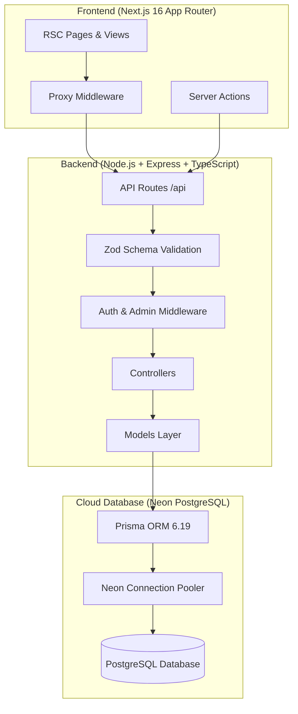

# 🎓 LearnHub — Enterprise-Grade Learning Management System (LMS)

[](https://nextjs.org/)
[](https://react.dev/)
[](https://www.typescriptlang.org/)
[](https://tailwindcss.com/)
[](https://expressjs.com/)
[](https://neon.tech/)
[](https://www.prisma.io/)
[](LICENSE)

A modern, high-performance, full-stack Learning Management System (LMS) built with the **PERN stack (PostgreSQL, Express, React/Next.js, Node.js)**. Designed with Next.js 16 App Router, React Server Components (RSC), Tailwind CSS v4, AMOLED pure black dark mode, and Neon Serverless PostgreSQL with Prisma ORM.

---

## 🌐 Live Deployments

| Component | Platform | URL |
| :--- | :--- | :--- |
| **Frontend Web App** | Vercel | [https://learnhub-learning.vercel.app](https://learnhub-learning.vercel.app) |
| **Backend REST API** | Render | [https://learnhub-k5jp.onrender.com](https://learnhub-k5jp.onrender.com) |
| **API Health Check** | Render | [https://learnhub-k5jp.onrender.com/api/health](https://learnhub-k5jp.onrender.com/api/health) |
| **Database** | Neon Cloud | Serverless PostgreSQL (Singapore `ap-southeast-1`) |

---

## 🚀 Key Features

### 🎓 1. Student Portal & Learning Experience
- **Dynamic Course Catalog (`/`, `/courses`):** Browse 12+ real-world courses with instant category filtering, price calculations, lecture counts, and discount badges.
- **Interactive Course Details (`/courses/[id]`):** Deep dive into curriculum outlines, instructor bios, enrolled stats, and collapsible lecture accordions.
- **Click-to-Load YouTube Facade Player:** Eliminates third-party iframe render blocking, improves initial load performance by 10x, and ensures privacy using `youtube-nocookie.com`.
- **Certificates Dashboard (`/certificates`):** Dynamic credential tracking with distinction grades, verifiable credential IDs, and printable certificate downloads.
- **Learning Progress Tracker (`/progress`):** Real-time progress bars, lecture watch completion counters, and study duration analytics.
- **Community Forum (`/community`):** Interactive peer discussions, technical Q&A topics, staff picks, solved badges, and upvoting counters.
- **Skill Quizzes & Assessments (`/quiz`):** Module-end assessments categorized by difficulty (Beginner, Intermediate, Advanced) with pass scores and retake capabilities.

### 🛡️ 2. Secure Authentication & Role-Based Access Control
- **Unified 3-Way Auth Hub (`/auth`):**
  - **Student Login:** Email & password authentication with JWT sessions.
  - **Student Registration:** Instant account creation with client & server-side validation.
  - **Administrator Portal:** Direct admin sign-in tab that routes platform admins directly to `/admin`.
- **Google OAuth 2.0 Integration:** Single-click sign-in with Google, dynamic origin-aware redirect URIs, and automatic `STUDENT` role provisioning.
- **Security Primitives:** HttpOnly, Secure, SameSite `Lax` session cookies, helmet security headers, rate limiting (100 req / 15 min), and bcrypt password hashing (10 rounds).
- **Personalized Header & Profile (`/profile`):** Conditional topbar avatar & name display, user initials generator, and dedicated user profile management.

### ⚙️ 3. Administrator Dashboard (`/admin`)
- **Full Course CRUD:** Add, edit, or delete courses with thumbnail image preview, pricing, and discount calculations.
- **Relational Lecture CRUD:** Add, edit, reorder, or remove video lectures per course with YouTube URL validation.
- **On-Demand Cache Invalidation:** Server Actions trigger instant Next.js cache revalidation (`updateTag` and `revalidatePath`) to reflect database updates with zero downtime.
- **Unauthorized Protection:** Multi-layer middleware and RSC-level verification guarding all `/admin/*` routes.

### 🎨 4. Design System & Accessibility
- **Day & AMOLED Pure Black Theme:** Switch between a pristine Day mode (`#f8f9fa` bg, `#ffffff` cards) and true AMOLED dark mode (`#000000` bg, `#1f1f1f` borders) via an SSR-safe `useSyncExternalStore` toggle.
- **Matched Custom SVG Iconography:** Precision stroke-width icons matching all 6 sidebar navigation menus.
- **Collapsible Sidebar:** Smooth circular toggle (`«` / `»`) expanding or collapsing the navigation rail with zero layout shift.
- **Strict Mobile-First Responsiveness:** Zero horizontal overflow, minimum 44px touch targets (`min-h-11`), and responsive data tables adapting to stacked card views.

---

## 🏛️ System Architecture



---

## 📂 Monorepo Project Structure

```text
LearnHub/
├── client/                     # Next.js 16 App Router Frontend
│   ├── src/
│   │   ├── actions/            # Next.js Server Actions (Auth, Course, Lecture)
│   │   ├── app/
│   │   │   ├── (auth)/         # Unified Single Page Auth (/auth)
│   │   │   ├── (public)/       # Student Portal (/, /courses, /certificates, /progress, /community, /quiz, /profile)
│   │   │   ├── admin/          # Protected Admin Dashboard (/admin, /admin/login)
│   │   │   └── api/auth/       # Google OAuth Route Handlers
│   │   ├── components/         # Reusable UI (Sidebar, Topbar, VideoPlayer, CourseCard, BrandLogo)
│   │   ├── lib/                # API client, session helpers, YouTube utilities
│   │   ├── proxy.ts            # Next.js 16 Request Interception / Proxy
│   │   └── types/              # Shared TypeScript definitions
│   ├── .env.example
│   └── package.json
│
├── server/                     # Express.js TypeScript Backend
│   ├── prisma/
│   │   ├── schema.prisma       # Database models (User, Course, Lecture, Certificate, etc.)
│   │   └── seed.ts             # Rich seed dataset (Admin + 12 Courses + 38 Lectures + 48 Portal Items)
│   ├── src/
│   │   ├── config/             # Prisma client & environment variables validation
│   │   ├── controllers/        # Request handlers (auth, course, lecture, portal)
│   │   ├── middleware/         # Security, rate limiter, JWT auth, admin guard, error handler
│   │   ├── models/             # Database access layer
│   │   ├── routes/             # RESTful API route definitions
│   │   ├── utils/              # AppError, JWT signer, async handler
│   │   └── validators/         # Zod input schemas
│   ├── .env.example
│   └── package.json
│
├── pnpm-workspace.yaml         # Monorepo configuration
└── README.md
```

---

## 🗄️ Database Schema (Neon PostgreSQL)

| Model | Description | Key Fields |
| :--- | :--- | :--- |
| **`User`** | Platform accounts | `id`, `name`, `email`, `passwordHash`, `googleId`, `role` (`STUDENT` / `ADMIN`), `createdAt` |
| **`Course`** | Published courses | `id`, `title`, `description`, `price`, `thumbnailUrl`, `instructorName`, `duration`, `discountPercent` |
| **`Lecture`** | Video curriculum | `id`, `courseId`, `title`, `description`, `videoUrl`, `position` (Cascade delete with Course) |
| **`Certificate`** | Earned credentials | `id`, `certCode`, `title`, `issuer`, `instructor`, `issueDate`, `grade`, `skills`, `verified` |
| **`LearningProgress`** | Student course tracking| `id`, `courseId`, `title`, `completedLectures`, `totalLectures`, `percent`, `status`, `timeSpent` |
| **`Discussion`** | Community posts | `id`, `title`, `category`, `author`, `avatar`, `replies`, `upvotes`, `badge`, `courseTitle` |
| **`Quiz`** | Topic assessments | `id`, `title`, `course`, `questions`, `duration`, `difficulty`, `passScore`, `status`, `bestScore` |

---

## 📡 RESTful API Endpoints

### 🔐 Authentication (`/api/auth`)
| Method | Endpoint | Description | Auth Required |
| :--- | :--- | :--- | :--- |
| `POST` | `/api/auth/register` | Register a new student account | ❌ Public |
| `POST` | `/api/auth/login` | Login with email & password | ❌ Public |
| `POST` | `/api/auth/google` | Google OAuth token exchange | ❌ Public |
| `GET` | `/api/auth/me` | Fetch authenticated user profile | ✅ Bearer JWT |

### 📚 Courses & Lectures (`/api/courses`)
| Method | Endpoint | Description | Auth Required |
| :--- | :--- | :--- | :--- |
| `GET` | `/api/courses` | List all courses (paginated) | ❌ Public |
| `GET` | `/api/courses/:id` | Get course details with lectures | ❌ Public |
| `POST` | `/api/courses` | Create a new course | 👑 Admin Only |
| `PUT` | `/api/courses/:id` | Update course metadata | 👑 Admin Only |
| `DELETE` | `/api/courses/:id` | Delete course & all lectures | 👑 Admin Only |
| `POST` | `/api/courses/:id/lectures`| Add a lecture to course | 👑 Admin Only |
| `PUT` | `/api/lectures/:id` | Update lecture details | 👑 Admin Only |
| `DELETE` | `/api/lectures/:id` | Delete a specific lecture | 👑 Admin Only |

### 🏆 Portals & Engagement
| Method | Endpoint | Description | Auth Required |
| :--- | :--- | :--- | :--- |
| `GET` | `/api/certificates` | Fetch verified certificates list | ❌ Public |
| `GET` | `/api/progress` | Fetch course learning progress | ❌ Public |
| `GET` | `/api/community` | Fetch active forum discussions | ❌ Public |
| `GET` | `/api/quizzes` | Fetch available & completed quizzes | ❌ Public |
| `GET` | `/api/health` | Server uptime & status check | ❌ Public |

---

## 🛠️ Local Development Setup

### Prerequisites
- [Node.js](https://nodejs.org/) (v20.x or v22.x LTS)
- [pnpm](https://pnpm.io/) (`corepack enable && corepack prepare pnpm@latest --activate`)
- PostgreSQL database instance (Local or [Neon Serverless](https://neon.tech))

### 1. Clone Repository
```bash
git clone https://github.com/iMoloy/LearnHub.git
cd LearnHub
```

### 2. Backend Setup (`server/`)
```bash
cd server
pnpm install

# Configure environment
cp .env.example .env
# Edit .env with your Neon DATABASE_URL, DATABASE_URL_UNPOOLED, and JWT_SECRET

# Sync Prisma Schema & Seed Database
pnpm exec prisma db push
pnpm exec ts-node prisma/seed.ts

# Start Express Dev Server (runs on port 4000)
pnpm dev
```

### 3. Frontend Setup (`client/`)
```bash
cd ../client
pnpm install

# Configure environment
cp .env.example .env.local
# Set API_URL=http://localhost:4000

# Start Next.js Dev Server (runs on port 3000)
pnpm dev
```

Visit [http://localhost:3000](http://localhost:3000) in your browser.

---

## 🔑 Demo & Test Credentials

| Role | Email | Password | Access Level |
| :--- | :--- | :--- | :--- |
| **Administrator** | `admin@learnhub.com` | `Admin123!` | Full Admin Panel (`/admin`) + CRUD Permissions |
| **Student** | *(Register any email or Continue with Google)* | *(Your Password)* | Student Portal (`/`, `/courses`, `/profile`, etc.) |

---

## 🚢 Deployment Guide

### Backend on [Render](https://render.com)
1. Create a new **Web Service** on Render and connect repository `iMoloy/LearnHub`.
2. Configure settings:
   - **Root Directory:** `server`
   - **Runtime:** `Node`
   - **Build Command:** `pnpm install && pnpm build`
   - **Start Command:** `pnpm start`
3. Add Environment Variables:
   - `NODE_ENV`: `production`
   - `DATABASE_URL`: Your pooled Neon connection string
   - `DATABASE_URL_UNPOOLED`: Your direct unpooled Neon connection string
   - `JWT_SECRET`: A secure random 64-char string
   - `FRONTEND_URL`: Your Vercel frontend URL
   - `ADMIN_EMAILS`: `admin@learnhub.com`
   - `GOOGLE_CLIENT_ID`: Your Google OAuth Client ID
   - `GOOGLE_CLIENT_SECRET`: Your Google OAuth Secret

### Frontend on [Vercel](https://vercel.com)
1. Import repository `iMoloy/LearnHub` into Vercel.
2. Configure project:
   - **Root Directory:** `client`
   - **Framework Preset:** `Next.js`
3. Add Environment Variables:
   - `API_URL`: Your Render backend URL (e.g. `https://learnhub-k5jp.onrender.com`)
   - `SESSION_COOKIE_NAME`: `learnhub_token`
   - `GOOGLE_CLIENT_ID`: Your Google OAuth Client ID
   - `GOOGLE_REDIRECT_URI`: `https://your-domain.vercel.app/api/auth/google/callback`

---

## 📄 License
This project is open-source and available under the [MIT License](LICENSE).
